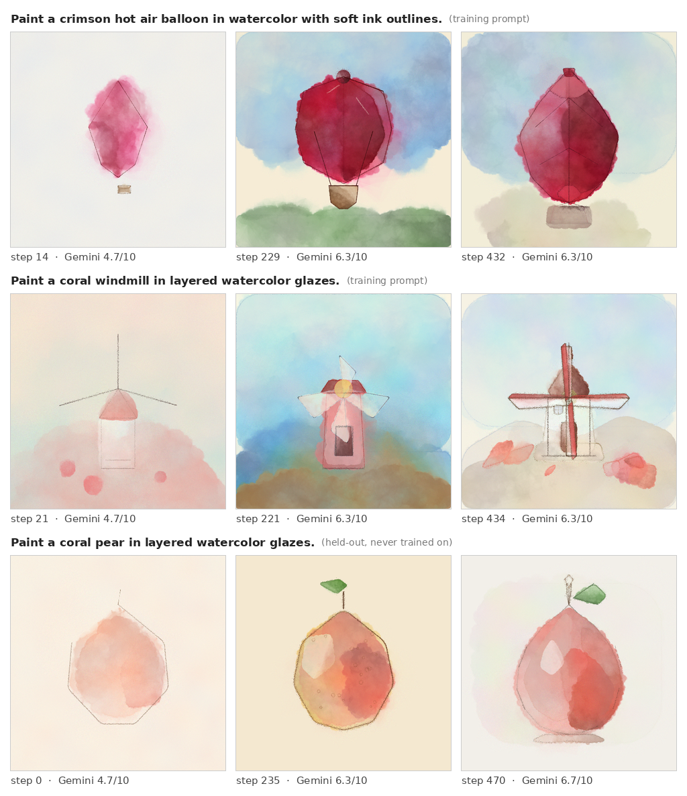
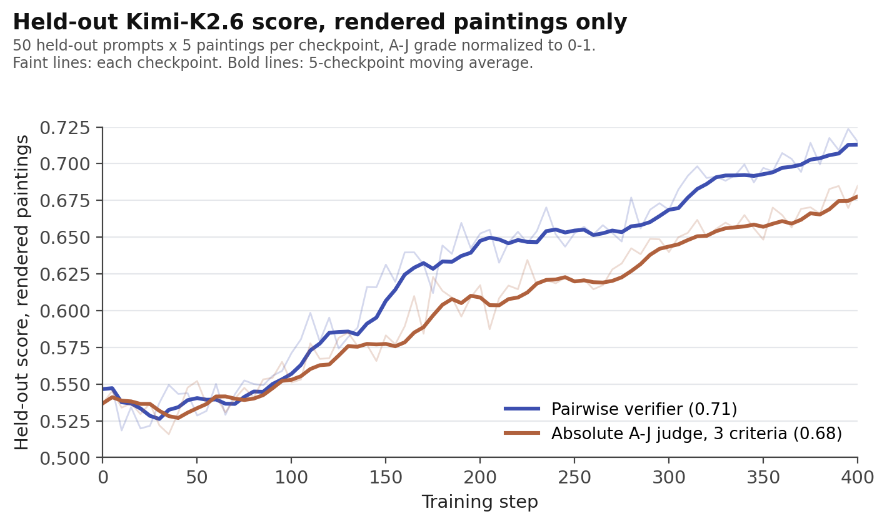

# paint_rl: RL for painting with code, rewarded by a multimodal LLM-as-a-Verifier

`Inkling-Small` learns to paint watercolors by writing
[p5.brush](https://github.com/acamposuribe/p5.brush) sketches. Each sketch is rendered
headlessly to a PNG. The paintings in a rollout group are compared against each other by
a multimodal verifier, and group-centered rewards update the policy on Tinker. An
LLM-as-a-Judge baseline (`reward_mode=judge`) scores each painting on its own instead,
under otherwise identical settings. The task
follows ["Training AI to Paint with Code"](https://surya.website/rling-qwen-to-paint-with-code);
the reward follows [LLM-as-a-Verifier](https://github.com/llm-as-a-verifier/llm-as-a-verifier).



*From an earlier verifier run, graded by Gemini at the time: two training prompts as
they came round during the run, and one held-out prompt (never trained on) at three
checkpoints. Each cell is the best of that step's five paintings by Gemini score.*

## Models

| Role | Model | How |
|---|---|---|
| Policy | `thinkingmachines/Inkling-Small` | LoRA rank 32 on Tinker, `tml_v0` renderer, thinking effort 0.7, 8k-token budget |
| Training reward (`reward_mode=verifier`, default) | `thinkingmachines/Inkling-Small` | Self-verification with `llm_verifier.compare` over Tinker's OpenAI-compatible endpoint, thinking effort 0.2, token logprobs, 4 repeats |
| Training reward (`reward_mode=judge`) | `thinkingmachines/Inkling-Small` | LLM-as-a-Judge: same endpoint, thinking effort 0.2, an absolute letter grade A-J (1-10) per painting on each of the verifier's three criteria |
| Held-out evaluator | `moonshotai/Kimi-K2.6` | Tinker's native sampler; the judge's prompts, an absolute letter grade A-J (1-10) per held-out painting on each of the three criteria, normalized to 0-1; never part of the reward |

## Quickstart

```bash
git clone https://github.com/jackyk02/paint_tinker.git && cd paint_tinker
cp .env.example .env && $EDITOR .env   # TINKER_API_KEY (everything runs on Tinker)
set -a && . ./.env && set +a
./setup.sh                             # vendored cookbook + paint-rl extra + Chromium

# Train with LLM-as-a-Verifier (400 steps, about 32 hours)
python -m tinker_cookbook.recipes.paint_rl.train reward_mode=verifier log_path=/tmp/paint_rl/verifier
# ... and/or the LLM-as-a-Judge baseline (400 steps, about 25 hours; separately, or at
# the same time in another shell)
python -m tinker_cookbook.recipes.paint_rl.train reward_mode=judge log_path=/tmp/paint_rl/judge
# Add behavior_if_log_dir_exists=resume to continue from the last checkpoint after an
# interruption, and raise max_steps (e.g. max_steps=600) to train further

# In another shell per run: evaluate every checkpoint on the held-out prompts as it appears
python -m tinker_cookbook.recipes.paint_rl.eval_checkpoints log_path=/tmp/paint_rl/verifier
python -m tinker_cookbook.recipes.paint_rl.eval_checkpoints log_path=/tmp/paint_rl/judge

# Compare the two on the held-out score, tie rate and training curves
python -m tinker_cookbook.recipes.paint_rl.compare_runs \
    runs='{"verifier": "/tmp/paint_rl/verifier", "judge": "/tmp/paint_rl/judge"}' out=compare.png
```

Every knob is in
[`train.py`](tinker-cookbook/tinker_cookbook/recipes/paint_rl/train.py); the recipe's
[README](tinker-cookbook/tinker_cookbook/recipes/paint_rl/README.md) covers the design.

## Defaults

| | |
|---|---|
| Steps | 400, each 8 prompts x 5 rollouts |
| Optimizer | importance-sampling policy gradient, group-centered advantages, lr 4e-5 |
| Reward | `0.05 * compiled + 0.05 * length_ok + 0.90 * score`, in both modes |
| Verifier | effort 0.2; 3 criteria x 4 slot-swapped repeats, full round robin: 120 calls per group, a whole step (960) in flight |
| Judge | effort 0.2; 3 calls per painting (one per criterion), letters A-J (10 to 1), mean -> `(s - 1) / 9`; tied paintings get equal reward; `scorer/top_tie` logs how often a group's top score is tied |
| Prompts | 1400: 43 subjects x 8 colors x 4 styles, plus 8 skill prompts x 4 styles; 256 training, 50 held-out spread over every subject |
| Rendering | 40 sketches at once (one step), ~4 pages per headless browser |
| Checkpoints | every 5 steps, kept on Tinker indefinitely |
| Held-out evaluation | separate process, base model + every checkpoint, 50 prompts x 5 paintings, three Kimi-K2.6 calls per painting, one per criterion (750 per checkpoint, all in flight) |

## How it works

1. **Prompt.** For example, `Paint a teal field of flowers on a rolling hillside in
   wet-on-wet watercolor wash.` Most prompts are a subject x color x style: 43 subjects
   drawn from what watercolorists commonly paint (flowers, still-life objects, scenes and
   two animals, across three difficulty tiers), 8 colors and 4 styles. A few are
   fully worded skill prompts that test counting, spatial relations, shape and
   perspective, such as `Paint exactly five red tulips in a vase, in layered watercolor
   glazes.`; they make up about a tenth of training. The 256 training prompts are
   balanced over subjects, colors and styles; the 50 held-out prompts are spread over
   every subject and are never trained on. `prompts.py` has the pool and
   `prompts_test.py` pins the split.
2. **Sketch.** The policy replies with one `javascript` block that defines `setup()` on a
   512x512 WEBGL canvas, using only an allow-list of about 20 brush calls. The page
   renders one frame and stops the draw loop itself.
3. **Render.** Headless Chromium with software WebGL and pinned p5 1.11.3 / p5.brush 1.1.4.
   A sketch *compiles* if it throws no error, makes at least three distinct `brush.*`
   drawing calls, and paints a non-blank canvas.
4. **Score.** *Verifier:* every pair of compiled paintings in a group is compared on one
   criterion at a time (content fidelity, color and style fidelity, watercolor craft and
   composition), four times, with the two slots swapped on alternate repeats so position
   bias cancels. The verifier
   grades each painting A-T, and the score is the *expected* grade under its token
   probabilities, not the sampled letter. A painting's score is its mean over the
   comparisons it took part in. *Judge:* each compiled painting is graded A-J (a 1-10 scale) on each of
   the same three criteria, one call each, and its score is the mean. In both modes, sketches that did not compile score 0 and sit
   out.
5. **Update.** Rewards are centered within each group and fed to an importance-sampling
   policy gradient (`tinker_cookbook/rl/train.py`).

## Results

Verifier vs judge, run under the current defaults (400 steps). The two
configs differ only in `reward_mode` (`verifier` vs `judge`): same seed, prompts,
policy, learning rate and token budget. Held-out: the 50 held-out prompts x 5
paintings per checkpoint, every 5 steps, graded by Kimi-K2.6 on the three criteria
(A-J, normalized to 0-1), which never sees training.



| Held-out | Verifier | Judge |
|---|---|---|
| Score, base model (step 0) | 0.453 | 0.442 |
| Score, step 400 | **0.712** | 0.674 |
| Score, mean of steps 150-400 | **0.660** | 0.627 |
| Rendered paintings only, mean of steps 150-400 | **0.669** | 0.635 |
| Best of 5, mean of steps 150-400 | **0.801** | 0.782 |
| Pass@5, mean of steps 150-400 | **65.5%** | 60.3% |
| Pass@5, step 400 | **78%** | 64% |
| Render rate, step 0 -> 400 | 83% -> 100% | 82% -> 98% |

| Training | Verifier | Judge |
|---|---|---|
| Groups whose top score is tied (`scorer/top_tie`) | 0% | 38% (47% over the last 50 steps) |
| Reward-model calls per painting | ~24 | 3 |
| Minutes per step (last 50 steps) | 4.8 | 3.8 |

Score is the mean over all 250 paintings, with a failed render scoring 0. Best of 5
is the best painting's score per prompt, averaged over prompts. Pass@5 is the share
of prompts where at least one painting averages 8/10 or better (0.78 on 0-1).

- **The two arms are even for the first ~100 steps; then the verifier pulls ahead**
  and stays ahead by about 0.03-0.04 to step 400, on all paintings and on rendered
  paintings alone.
- **The judge's ties cost it signal.** A written A-J letter often gives the best
  paintings in a group the same score, so they get the same advantage; the
  verifier's expected-grade scores never tied.
- **Neither arm had plateaued at step 400.** Both were still rising slowly.
- **The verifier costs more.** It makes about 8x the reward-model calls of the judge
  and each step takes about 25% longer.

`results/verifier_vs_judge/` holds each run's config, training and held-out metrics,
and every checkpoint's Tinker `state_path` and `sampler_path` with its held-out
scores. The checkpoints are kept on Tinker indefinitely.

## Test-time best-of-5

For deployment, `best_of_n.py` samples five sketches from a checkpoint, renders them,
and lets base Inkling-Small pick one with the same pairwise tournament that rewarded
training. Sketches that fail to render are never picked.

```bash
python -m tinker_cookbook.recipes.paint_rl.best_of_n \
    model_path=tinker://<run id>/sampler_weights/000400 \
    "prompts.0=Paint a red fox curled up in the snow, in loose watercolor washes." \
    out_dir=/tmp/paint_rl/best_of_n
```

On the step-400 checkpoint's held-out paintings (50 prompts x 5), the verifier's pick
scores higher with Kimi than a random one:

| Held-out Kimi score (0-1) | |
|---|---|
| Random painting of the five (the plain policy) | 0.712 |
| Verifier's pick (best-of-5) | **0.752** |
| Best of the five by Kimi (oracle) | 0.841 |

The verifier picks Kimi's favorite in 32% of prompts (20% by chance). The step-400
adapter is on the Hugging Face Hub as
[`jackyk02/inkling-small-paint-rl-verifier-step400`](https://huggingface.co/jackyk02/inkling-small-paint-rl-verifier-step400).

`web/server.py` serves the same pipeline as a small web studio: a visitor types a
request (or opens an example), and the page shows all five paintings, their verifier
scores, the code and the pick.

```bash
python -m tinker_cookbook.recipes.paint_rl.web.server \
    model_path=tinker://<run id>/sampler_weights/000400 port=8765
```

## Outputs

Under `<log_path>/`:

| Path | Content |
|---|---|
| `metrics.jsonl` | training metrics per step |
| `checkpoints.jsonl` | every saved checkpoint, with its Tinker `sampler_path` |
| `paintings/train/step_XXXX/<prompt id>/` | each rollout's `.png`, `.js` and raw response, plus `group.json` with every verifier score |
| `paintings/index.jsonl` | one row per rollout: reward, score, compile result, paths |
| `iteration_XXXXXX/` | the cookbook's per-step HTML report and rollout summaries |
| `heldout_eval/metrics.jsonl` | held-out metrics per evaluated checkpoint; headline `test/env/all/eval_strong/score` (Kimi) |
| `heldout_eval/paintings/` | the held-out paintings, filed by checkpoint step |

Judge progress by the held-out Kimi score: the verifier's reward is relative to the other
paintings in a group and the judge's is on its own scale, so neither is comparable across
steps or between the two modes. `gallery.py`, `progression.py` and `compare_runs.py` turn
the outputs into an HTML gallery, per-step best-painting sheets and comparison curves
(`compare_runs.py` includes the held-out score and the top-score tie rate).

## Repository layout

| Path | Content |
|---|---|
| `tinker-cookbook/` | [tinker-cookbook](https://github.com/thinking-machines-lab/tinker-cookbook), vendored from upstream `e6fa1cc`, with the recipe and a `paint-rl` dependency extra added |
| `tinker-cookbook/tinker_cookbook/recipes/paint_rl/` | the recipe |
| `setup.sh` | installs the vendored cookbook with the `paint-rl` extra (`llm-verifier`, `openai`, `playwright`) and Chromium |
| `.env.example` | the credentials the run needs |
| `results/` | `verifier_vs_judge/`: configs, metrics and checkpoint paths of the verifier and judge runs; `examples_early_to_late.png` |
